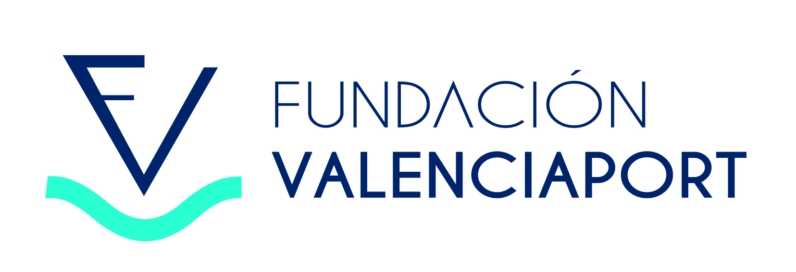
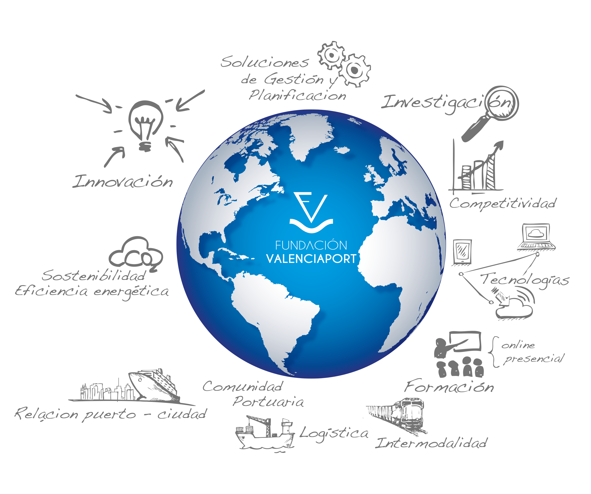

  

### Conocimiento e innovación para la comunidad logístico-portuaria
[Web institucional](https://www.fundacionvalenciaport.com/)

---
     
La **Fundación Valenciaport** es el centro de conocimiento e innovación logística de los puertos de Valencia, Sagunto y Gandía. Trabajamos para contribuir al posicionamiento del clúster Valenciaport mediante la innovación, el emprendimiento y la formación.
 

## Qué hacemos
     
Impulsamos la transformación de la comunidad logístico-portuaria a través de:
 
- **Innovación**: desarrollamos y participamos en proyectos que dan respuesta a los retos del sector marítimo, portuario y logístico.
- **Emprendimiento**: conectamos talento, empresas y tecnología para acelerar soluciones innovadoras para la economía azul.
- **Formación**: promovemos la capacitación y la profesionalización de los profesionales del clúster logístico-portuario.

## En GitHub

En esta organización compartimos, cuando corresponde, el software, las herramientas y los resultados técnicos derivados de nuestros proyectos de innovación.

Visita nuestros repositorios para conocer las iniciativas disponibles y sus condiciones de uso.

## Contacto

- 🌐 [fundacion.valenciaport.com](https://www.fundacionvalenciaport.com/)
- 📍 València, España

---

  Fundación Valenciaport · Innovación, emprendimiento y formación para el sector logístico-portuario.

<!--

**Here are some ideas to get you started:**

🙋‍♀️ A short introduction - what is your organization all about?
🌈 Contribution guidelines - how can the community get involved?
👩‍💻 Useful resources - where can the community find your docs? Is there anything else the community should know?
🍿 Fun facts - what does your team eat for breakfast?
🧙 Remember, you can do mighty things with the power of [Markdown](https://docs.github.com/github/writing-on-github/getting-started-with-writing-and-formatting-on-github/basic-writing-and-formatting-syntax)
-->
